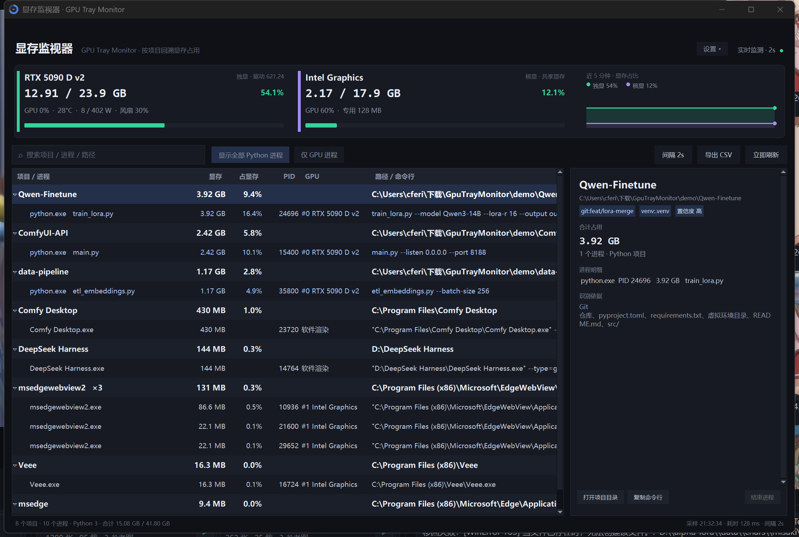

# GPU Tray Monitor · 显存监视器

[中文](README.md) · **English** · version **v1.0.0** · [changelog](CHANGELOG.md)

A GPU VRAM monitor that lives in the Windows system tray: the icon shows VRAM pressure, a compact strip on the
taskbar shows the key numbers, and the main window groups processes by **project** — every `python.exe` is
traced back to the project it belongs to (including the venv/conda and the git branch).



## Highlights

- **No third-party dependencies** — Python standard library plus built-in Windows APIs (NVML / PDH / DXGI / PEB)
- **Per-project attribution** — reads command line, working directory and environment from the process PEB,
  then walks up looking for `.git` / `pyproject.toml` / `requirements.txt`
- **Tray first** — launching gives you a tray icon and a taskbar strip (VRAM · pressure · util · network), no window
- **Two builds** — self-contained exe (bundled Python 3.13) or script build (Python 3.10+)
- Windows 10/11 x64; tested on RTX 5090 D v2 24 GB + Intel iGPU, Windows 11 26H2

## Quick start

1. Grab `GpuTrayMonitor-v1.0.0-portable.zip` from [Releases](https://github.com/yuke666/GpuTrayMonitor/releases/latest) and extract it
2. Run `setup-this-pc.bat` once — trusts the bundled certificate, clears the download mark, creates a desktop shortcut
   (all per-user, no administrator rights)
3. Double-click **GPU Monitor** on the desktop

The exe bundles its own Python. Already have Python 3.10+? Just double-click `start-tray.vbs`.

## Usage

| Action | Result |
| --- | --- |
| Left-click the tray icon / click the taskbar strip | open the main window |
| Right-click the tray icon | show window, refresh, pause, interval, four switches, quit |
| Drag the taskbar strip | move it along the taskbar, position is remembered |
| Right side of the strip (↑ / ↓) | summed up/down rate of all adapters (loopback excluded) |
| Right side of the strip | ↑ / ↓ show the summed up/down rate of **all network adapters** (loopback excluded) |
| Close the main window | hide to the tray, monitoring continues |

The window lists one row per project plus its processes (VRAM, share, PID, adapter, command line). The detail
panel shows argv, cwd, environment, interpreter, virtualenv and git branch, and can export the snapshot to CSV.

The window's **设置 ▾** menu and the tray menu expose the same four switches, and either side updates the other:

| Switch | Effect |
| --- | --- |
| Start with Windows | launches at login |
| Start in tray | no main window on launch |
| Taskbar strip | VRAM strip on the taskbar |
| Show all Python processes | include processes without GPU memory |

## Attribution

Enumerate processes → read the PEB for command line, cwd and environment → pick the script path → walk up the
tree scoring markers (`.git` 100, `pyproject.toml` 80, `requirements.txt` 40, below 35 keep walking) →
detect venv/conda and the git branch. Unusual layouts can be fixed with `overrides` in the config.

## Data sources

| Data | Source |
| --- | --- |
| Total/used VRAM, utilization, temperature | NVML (`nvml.dll`, no CUDA toolkit needed) |
| Per-process VRAM | PDH `\GPU Process Memory(*)\Local Usage` |
| Per-process GPU utilization | PDH `\GPU Engine(*)\Utilization Percentage` |
| Adapter / LUID mapping | DXGI `IDXGIFactory1::EnumAdapters1` |
| Command line, cwd, environment | `NtQueryInformationProcess` + PEB |

## Configuration

`%LOCALAPPDATA%\GpuTrayMonitor\config.json` (falls back to the program folder); log is `monitor.log` next to it.

| Key | Default | Meaning |
| --- | --- | --- |
| `interval` | `2.0` | sampling interval, seconds |
| `start_hidden` | `true` | start in the tray |
| `taskbar_hud` | `true` | taskbar strip |
| `show_all_python` | `true` | list all Python processes |
| `autostart` | `false` | start with Windows |
| `overrides` | `[]` | custom attribution rules |

## Troubleshooting

- **"Open File - Security Warning" on the exe** → run `portable\unblock.bat`; if it persists, `portable\allow-launch.bat`
- **Blue SmartScreen block** → the certificate is self-signed and SmartScreen ignores local trust; launch through
  the desktop shortcut (`pythonw.exe`) or buy a CA-issued certificate
- **No tray icon** → `portable\GpuMon.exe --selftest-tray` prints the Win32 error; `5` means a permission problem
  (elevated launch, or the files carry a Low integrity label)

## Build

```powershell
python tools\fetch_wheels.py
$env:PYTHONPATH="$PWD\.build\libs"   # after extracting .build\wheels\*.whl into .build\libs
python -m PyInstaller --noconfirm --clean --onedir --windowed --name GpuMon `
  --icon build\app.ico --version-file build\version.txt gpumon.pyw
```

Use `--onedir`, not `--onefile`: a onefile build unpacks into `%TEMP%` and fails with
`Could not create temporary directory!` under strict policy.

---

Full manual: [docs/guide.en.md](docs/guide.en.md) · 中文: [README.md](README.md) · changelog: [CHANGELOG.md](CHANGELOG.md)
