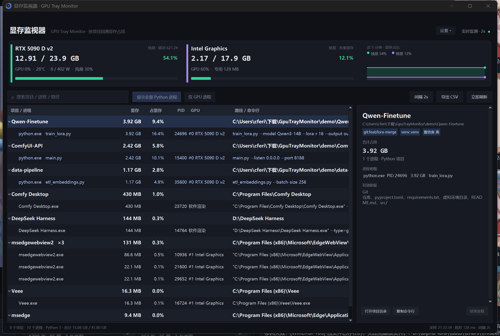

# 显存监视器 · GPU Tray Monitor

**中文** · [English](README.en.md) · 版本 **v1.0.0** · [更新记录](CHANGELOG.md)

常驻系统托盘的 GPU 显存监控：托盘图标显示显存压力，任务栏一条关键指标，
主窗口按**项目**聚合进程，能把每个 `python.exe` 回溯到所属工程（含 venv / conda / git 分支）。



## 亮点

- **零第三方依赖** — 只用 Python 标准库 + Windows 自带 API（NVML / PDH / DXGI / PEB）
- **按项目聚合** — 用 PEB 读命令行、工作目录、环境变量，向上找 `.git` / `pyproject.toml` / `requirements.txt`
- **托盘优先** — 启动即为托盘图标 + 任务栏指标条（显存 · 占比 · 使用率 · 网速），不弹窗口
- **两种形态** — 免安装 exe（内置 Python 3.13）或脚本版（Python 3.10+）
- Windows 10/11 x64；实测 RTX 5090 D v2 24 GB + Intel 核显，Windows 11 26H2

## 快速开始

1. 从 [Releases](https://github.com/yuke666/GpuTrayMonitor/releases/latest) 下载 `GpuTrayMonitor-v1.0.0-portable.zip` 并解压
2. 双击 `setup-this-pc.bat` —— 信任证书、清下载标记、建桌面快捷方式（全部当前用户级，无需管理员）
3. 双击桌面 **GPU Monitor**

不想装 Python 依赖？exe 版已内置解释器。已装 Python 3.10+ 的话，直接双击 `start-tray.vbs` 也行。

## 用法

| 操作 | 结果 |
| --- | --- |
| 左键托盘图标 / 点任务栏指标条 | 打开主窗口 |
| 右键托盘图标 | 显示窗口、刷新、暂停、采样间隔、四项开关、退出 |
| 拖动任务栏指标条 | 沿任务栏移动，位置记住 |
| 指标条右侧 ↑ / ↓ | 所有网卡的上行 / 下行总速率（不含回环） |
| 看指标条右侧 | ↑ / ↓ 为**所有网卡**的实时上行/下行总速率（不含回环） |
| 关闭主窗口 | 收进托盘继续监测 |

主窗口按项目分组列出进程（显存、占比、PID、适配器、命令行），右侧详情面板显示命令行、工作目录、
环境变量、解释器、虚拟环境、git 分支，可导出 CSV。

主窗口「设置 ▾」和托盘右键是**同一组四项开关**，任意一侧改动立刻同步：

| 开关 | 作用 |
| --- | --- |
| 开机自动启动 | 登录后自动运行 |
| 启动时进托盘（不弹窗口） | 启动不显示主窗口 |
| 在任务栏显示关键指标 | 任务栏上的显存条 |
| 显示全部 Python 进程 | 是否列出无 GPU 占用的进程 |

## 项目回溯

枚举进程 → 读 PEB 拿命令行/工作目录/环境变量 → 取脚本路径 → 向上逐级打分
（`.git` 100、`pyproject.toml` 80、`requirements.txt` 40，低于 35 继续向上）→ 识别 venv/conda 与 git 分支。
特殊目录结构可在配置里用 `overrides` 修正。

## 数据来源

| 数据 | 来源 |
| --- | --- |
| 显存总量/已用、使用率、温度 | NVML（`nvml.dll`，不需要 CUDA 工具包） |
| 每进程显存 | PDH `\GPU Process Memory(*)\Local Usage` |
| 每进程 GPU 使用率 | PDH `\GPU Engine(*)\Utilization Percentage` |
| 适配器与 LUID | DXGI `IDXGIFactory1::EnumAdapters1` |
| 命令行 / 工作目录 / 环境变量 | `NtQueryInformationProcess` + PEB |

## 配置

`%LOCALAPPDATA%\GpuTrayMonitor\config.json`（不可写时回退到程序目录），日志同名 `monitor.log`。

| 字段 | 默认 | 说明 |
| --- | --- | --- |
| `interval` | `2.0` | 采样间隔（秒） |
| `start_hidden` | `true` | 启动直接进托盘 |
| `taskbar_hud` | `true` | 任务栏指标条 |
| `show_all_python` | `true` | 列出全部 Python 进程 |
| `autostart` | `false` | 开机自启 |
| `overrides` | `[]` | 自定义归类规则 |

## 常见问题

- **exe 弹“打开文件 - 安全警告”** → 跑 `portable\unblock.bat`；仍在就 `portable\allow-launch.bat`
- **蓝色 SmartScreen 拦截** → 自签名证书拿不到云端声誉，用桌面快捷方式启动（`pythonw.exe`），或买 CA 证书
- **没有托盘图标** → `portable\GpuMon.exe --selftest-tray` 看错误码；`5` 表示权限问题（管理员启动或文件被降权）

## 构建

```powershell
python tools\fetch_wheels.py
$env:PYTHONPATH="$PWD\.build\libs"   # 先解压 .build\wheels\*.whl 到 .build\libs
python -m PyInstaller --noconfirm --clean --onedir --windowed --name GpuMon `
  --icon build\app.ico --version-file build\version.txt gpumon.pyw
```

必须用 `--onedir`：单文件版要解压到 `%TEMP%`，在策略严格的机器上会报
`Could not create temporary directory!`。

---

完整手册：[docs/guide.md](docs/guide.md) · 英文：[README.en.md](README.en.md) · 更新记录：[CHANGELOG.md](CHANGELOG.md)
