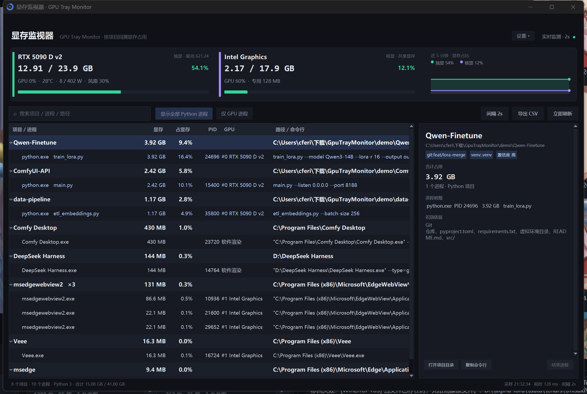
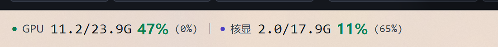

> 本页是完整手册；简短介绍见 [README](../README.md)。

# 显存监视器 · 详细手册

**中文** · [English](guide.en.md)

当前版本 **v1.0.0** · 更新记录见 [更新记录](../CHANGELOG.md)

常驻系统托盘的 GPU 显存监控：托盘图标显示显存压力，任务栏一条关键指标，主窗口按 **项目** 聚合进程，
能把每个 `python.exe` 回溯到它所属的工程目录（连 conda / venv、git 分支一起标出来）。





- **零依赖**：只用 Python 标准库 + Windows 自带 API（NVML / PDH / DXGI / PEB），不装 torch、不装 psutil
- **按项目聚合**：用 PEB 读取进程的命令行、工作目录、环境变量，向上找 `.git` / `pyproject.toml` / `requirements.txt`
- **两种形态**：免安装 exe（内置 Python）或脚本（需要本机 Python 3.10+）
- **托盘优先**：双击启动直接进托盘，不弹窗口；任务栏指标条显示 `已用/最大显存 · 占比 · 使用率`
- **Windows 10/11 x64**，实测环境：RTX 5090 D v2 24 GB + Intel 核显，Windows 11 26H2


## 快速开始

| 方式 | 做法 | 需要 Python |
| --- | --- | --- |
| **推荐（托盘直启）** | 桌面 `GPU Monitor` 快捷方式：直接进托盘，不弹主窗口，也不触发任何安全提示 | 需要 3.10+ |
| 免安装 exe | 双击 `portable\GpuMon.exe`（`_internal` 要和 exe 放一起） | 不需要 |
| 带窗口启动 | 桌面 `GPU Monitor (window)` 快捷方式，或双击 `start-gpumon.vbs` | 需要 3.10+ |
| 调试 | 双击 `debug-start.cmd`（保留控制台，能看到日志与异常） | 需要 3.10+ |
| 命令行 | `python gpumon.pyw --hidden` / `--show` / `--verbose` / `--selftest-tray` | 需要 3.10+ |

### 桌面快捷方式为什么不会弹「安全警告」

两个快捷方式都不是直接指向 `.exe` 或 `.vbs`，而是指向 **`pythonw.exe`**（Python Software Foundation 签名）：

`
目标：C:\Users\<你>\AppData\Local\Programs\Python\Python313\pythonw.exe
参数："<项目路径>\gpumon.pyw" --hidden        （窗口版用 --show）
起始位置：<项目路径>
`

Windows 检查的是被启动的那个文件，也就是 `pythonw.exe`；它在微软云端有充足声誉、
且是正规签名程序，所以不会出现「未知发布者 / 来自 Internet 的文件」询问。`gpumon.pyw`
只是作为参数传进去，不经过 shell 的脚本关联。

如果换机器后 Python 装在别处，右键快捷方式 → 属性 → 把「目标」改成那台机器上的 `pythonw.exe` 即可。
### 换台电脑：一条命令搞定

把整个 `GpuTrayMonitor` 文件夹拷过去，**双击 `setup-this-pc.bat`**，它会依次做五件事（全部是当前用户级，不需要管理员）：

| 步骤 | 做什么 | 为什么 |
| --- | --- | --- |
| 1 | 清除整个目录的"网络下载标记"（`Zone.Identifier`） | 避免"来自 Internet 的文件"提示 |
| 2 | 把 `GpuTrayMonitor-selfsigned.cer` 导入"受信任的根证书 + 受信任的发布者" | 让 exe 的签名在本机有效 |
| 3 | 把各安全区 `1806` 设为"允许" | 关掉旧式"你想运行此文件吗"询问 |
| 4 | 检查 SmartScreen 是否被策略覆盖 | 保持系统默认防护 |
| 5 | 验证 exe 签名，并创建桌面 `GPU Monitor` 快捷方式 | 快捷方式直接指向 `pythonw.exe`，双击即进托盘 |

撤销：`portable\restore-launch-prompt.bat`（恢复询问）、`portable\uninstall-cert.bat`（取消信任）。

> 第 3 步会关掉"下载的程序先询问"这道检查，属于安全性取舍；不做这一步也能用，
> 只是双击 exe 时会多问一句。运行 bat 时它会在屏幕上明确提示这一点。
### 启动方式与「直接进托盘」

默认就是**启动即进托盘**：窗口不弹出来，只在托盘放一个环形仪表图标，任务栏同时出现关键指标条。

| 参数 | 行为 |
| --- | --- |
| （无参数） | 按配置决定，默认进托盘 |
| `--hidden` / `--tray` | 强制进托盘 |
| `--show` / `--window` | 强制打开主窗口（覆盖配置） |
| `--selftest-tray` | 只测托盘注册，打印结果和错误码后退出 |

主窗口「设置 ▾」和托盘右键菜单现在是**同一组四项开关**，勾选状态用 `✓` 前缀显示（深色菜单里系统指示器看不清），
任一侧切换都会立刻同步到另一侧：

| 开关 | 作用 |
| --- | --- |
| 开机自动启动 | 在启动文件夹写一个 `.vbs`，登录后自动运行 |
| 启动时进托盘（不弹窗口） | 启动时不显示主窗口，直接常驻托盘 |
| 在任务栏显示关键指标 | 任务栏上的显存/占比/使用率条 |
| 显示全部 Python 进程 | 是否列出没有 GPU 占用的 Python 进程 |

`start_hidden` 也存在配置文件里：


- 主窗口「设置 ▾」→ **启动时进托盘（不弹窗口）**
- 托盘右键 → **启动时进托盘（不弹窗口）**
- 配置文件 `start_hidden`（默认 `true`）

想要"开机就自动进托盘"，把「开机自动启动」也勾上：登录后无窗口、直接出现在托盘。

### 托盘图标自检

主界面出现"系统未允许托盘图标"横幅时，先跑一次自检，它会打印 Windows 的真实返回值和错误码：

```powershell
.\portable\GpuMon.exe --selftest-tray
```

| 输出 | 含义 |
| --- | --- |
| `registered : True` + 一个 `icon rect` | 托盘正常，图标在通知区域里（可能在 `^` 溢出菜单中） |
| `registered : False`, `last error : 5` | 拒绝访问。最常见原因是**程序以管理员身份运行**，而任务栏是普通权限，低/高完整性进程无法放置托盘图标——用普通身份启动即可 |
| `registered : False`, 其它错误码 | 把错误码发我 |
**错误码 5 还有一种成因：进程被降权运行。** 检查 exe 的完整性标签：

```
icacls "portable\GpuMon.exe" | findstr Mandatory
```

如果显示 `Low Mandatory Level`，进程会以低完整性启动——既不能放托盘图标（UIPI 拒绝），
也写不进 `%LOCALAPPDATA%`（会回退到程序目录的 `.data`）。修复：

```
icacls "GpuTrayMonitor" /setintegritylevel (OI)(CI)M /T
```

把整个目录树改回 Medium 即可，不需要管理员权限。

**托盘图标没了，怎么把窗口找回来？** 点击任务栏上的关键指标条（数字那一块）即可；
或者关闭窗口时选"最小化"（没有托盘图标时程序会最小化到任务栏而不是隐藏）。
```

`portable` 是 PyInstaller 打出的**免安装目录版**（24 MB，内置 Python 3.13 与 tkinter）：
整个文件夹拷到任何 Windows 10/11 x64 机器双击即可，不需要安装 Python，也不需要 .py 文件。
它**不向 `%TEMP%` 解压任何东西**，因此不会被"受控文件夹访问"、杀软临时目录拦截影响，启动也比单文件版快约 1 秒。

`start-gpumon.vbs` 是**脚本方式**，换机器时要注意两点：

1. 目标机器必须装 Python 3.10+（python.org 的官方安装包默认自带 tkinter；安装时勾选"Add python.exe to PATH"更省事）；
2. 要把 `start-gpumon.vbs`、`gpumon.pyw`、`gpumon\` 文件夹**一起**拷过去，缺一不可。

脚本会依次在这些位置找 `pythonw.exe`：项目自带 `.venv` → `%LOCALAPPDATA%\Programs\Python\Python3xx` →
`%ProgramFiles%\Python3xx` → `pyw.exe`（py 启动器）→ `PATH`；全都找不到会**弹窗提示**并建议改用便携版，
不会像旧版那样双击了没反应。

> 早先的单文件版在部分机器上会报 `Could not create temporary directory!`（单文件模式需要先把内容解压到
> `%TEMP%`，被安全策略/杀软拦下就起不来）。如果你拿到的是单个 exe 且遇到这个报错，请改用本目录版。
>
> exe 未做代码签名，SmartScreen 可能提示"未知发布者"——点"更多信息 → 仍要运行"即可。

关闭窗口 = 收进托盘（不是退出）。退出请用托盘菜单或「设置 ▾ → 退出显存监视器」。

程序内置单实例保护：重复启动会把已在运行的窗口唤到前台。

---

## 代码签名（自签名证书）

`portable\GpuMon.exe` **已签名**：

| 项目 | 内容 |
| --- | --- |
| 签名者 | `CN=GpuTrayMonitor Self-Signed Code Signing` |
| 有效期 | 2029-11-16 |
| 算法 | SHA-256（无时间戳，自签名不需要） |
| 状态 | `Valid`（本机已导入信任） |

证书和 bat 都在 `portable\` 里：

| 文件 | 作用 |
| --- | --- |
| `GpuTrayMonitor-selfsigned.cer` | 公钥证书（发给别人只需要这个） |
| `install-cert.bat` | 导入到当前用户的"受信任的根证书颁发机构 + 受信任的发布者"，**不需要管理员** |
| `uninstall-cert.bat` | 从这两个存储里移除 |
| `certificate-notes.txt` | 中文说明 |

### 换一台机器怎么用

1. 把整个 `portable` 文件夹拷过去（exe、`_internal`、证书和 bat 要在同一个目录）；
2. **先**双击 `install-cert.bat`，看到 `Status : Valid` 即可；
3. 再双击 `GpuMon.exe`，属性 → 数字签名里能看到上面的签名者。

### 重新打包后要重新签名

签名是绑定到文件字节的，重新打包后必须重签（本机）：

```powershell
powershell -NoProfile -ExecutionPolicy Bypass -File tools\sign_exe.ps1 `
  -Exe ".\portable\GpuMon.exe"
```

脚本会复用已存在的证书（`Cert:\CurrentUser\My`），重新导出 `.pfx`/`.cer` 到 `build\signing\`，签名并导入信任。
私钥在 `build\signing\GpuTrayMonitor-selfsigned.pfx`（口令 `gputraymonitor`），**不要外传**。

### 局限（重要）

- 自签名只在**导入过这张证书**的机器上有效；没导入的机器会显示"签名无效/证书链未受信任"；
- **SmartScreen 完全不看本地证书库**：它用的是微软云端的"应用声誉"，自签名证书再受信任也改变不了它。
  所以装完证书仍可能弹蓝色"Windows 已保护你的电脑"——这不是签名没生效，而是另一套机制；
- 要对外公开分发、希望任何人下载都不提示，只能买 OV/EV 代码签名证书（约 ¥1000–4000/年，2023 年后私钥必须在硬件令牌或云端 HSM 中）。

### 当前推荐配置（已在本机生效）

| 项目 | 状态 | 作用 |
| --- | --- | --- |
| SmartScreen | 系统默认（`Warn`） | 保留微软云端声誉检查 |
| 各区「启动应用程序和不安全文件」`1806` | `0` = 允许 | 关掉旧式「打开文件 - 安全警告」询问 |
| `GpuMon.exe` 签名 | 自签名证书，`Valid` | 属性里显示签名者 |
| 日常启动 | 桌面 `GPU Monitor` → `pythonw.exe` | 不经过脚本/exe 关联，无任何提示 |

两项注册表位置（都是当前用户级，`allow-launch.bat` / `restore-launch-prompt.bat` 可一键切换）：

```
HKCU\Software\Microsoft\Windows\CurrentVersion\Internet Settings\Zones\{0..4}\1806 = 0
```

> `1806 = 0` 的代价：从网上下载的 exe/脚本也不再询问，等于放弃这道检查。
> 如果更看重防护，把 `1806` 恢复默认、并让 SmartScreen 保持开启——那样只有
> 自签名 exe 会被蓝色 SmartScreen 拦，脚本和快捷方式不受影响。

### 遇到拦截弹窗怎么办

先分清是哪一个——两者的成因和解决办法完全不同：

| 弹窗 | 样子 | 成因 | 解决办法 |
| --- | --- | --- | --- |
| **SmartScreen** | 蓝色全屏，"Windows 已保护你的电脑"，只有一个"不运行" | 微软云端**应用声誉**（不看本地证书） | 见下面 3、4 |
| **文件安全警告** | 小窗口，"打开文件 - 安全警告"，有"运行(R) / 取消" | 文件带 **Zone.Identifier**（网络下载标记） | 见下面 1、2 |

1. **右键 exe → 属性 → 最下方勾选"解除锁定" → 确定**（单个文件）；
2. 或者双击 `unblock.bat`，对整个目录批量清除（只清标记，不碰文件内容）；
3. 改用 `start-gpumon.vbs`：实际执行的是微软签名的 `pythonw.exe`，不经过 exe 声誉检查；
4. 关掉"检查应用和文件"（`disable-smartscreen.bat`，需管理员）：写
   `HKLM\SOFTWARE\Policies\Microsoft\Windows\System\EnableSmartScreen = 0` 与
   `HKLM\SOFTWARE\Microsoft\Windows\CurrentVersion\Explorer\SmartScreenEnabled = "Off"`，
   `restore-smartscreen.bat` 可还原（改完需注销或重启）。

> 从**压缩包里直接双击** exe 一定会弹"文件安全警告"：它会先解压到临时目录，副本带下载标记。
> 先解压到本地文件夹再运行即可。

> 注意：签名能解决的是"属性里显示签名者 / 证书链有效"，解决不了 SmartScreen 的云端声誉拦截，
> 也解决不了网络下载标记。这三件事经常被混为一谈。

---

## 托盘

- 图标是环形仪表：圆环填充比例 = 显存占用，颜色 = 压力（绿 < 65% < 黄 < 88% < 红）
- 悬停显示：`RTX 5090 D v2 8.85 GB/23.9 GB 37% | 占用最高 Qwen-Finetune 3.92 GB`
- 左键：显示 / 隐藏主窗口
- 右键菜单：显示主窗口、立即刷新、暂停监测、采样间隔（1/2/3/5/10 秒）、显示全部 Python 进程、**在任务栏显示关键指标**、开机自启、退出
- Windows 11 默认把新图标放进 `^` 溢出区，可以拖到任务栏固定

---

## 任务栏指标条

菜单里「在任务栏显示关键指标」默认开启，开启后任务栏最左侧直接显示一行文字（无底色）：


- 内容：`● GPU 11.2/23.9G 47% (0%) │ ● 核显 2.0/17.9G 11% (65%)`，按重要度排列：
  1. **已用 / 最大显存**（黑色主文字）
  2. **显存占用比**（加粗，按压力变色）
  3. **使用率**（括号内，次要信息）
  圆点颜色与主界面一致（独显绿 / 核显蓝紫）
- 背景完全透明，直接画在任务栏上，所以底色天然与任务栏一致；文字颜色跟随 Windows 的浅色 / 深色任务栏主题自动切换，透明色键也取同色系中性色，抗锯齿边缘不会发灰发黑
- 字号较大（主数值 18pt），高度会按任务栏实际高度自动收缩，不会被裁切
- 单击：打开主窗口；拖动：可以沿任务栏移动，位置会记住（`taskbar_hud_offset` / `taskbar_hud_y`）
- 右键：打开主窗口 / 隐藏指标条 / 退出
- 不抢焦点（`WS_EX_NOACTIVATE`）、不占 Alt+Tab、不占任务栏按钮位；跟随任务栏位置、高度和缩放变化
- 关掉主窗口后它依然在，随时能看到显存压力

实现方式：按 `Shell_TrayWnd` 的实时矩形定位一个无边框置顶浮层，而不是注册 DeskBand（后者需要 C++ COM 注册，Explorer 一重启就得重新加载）。浮层每秒重新置顶一次，避免被任务栏本身压下去。

---

## 界面

**显卡卡**：左边独显、中间核显（如有），右侧是两张卡的显存占比曲线。

- 每块都显示：显存 used/total、占用百分比、GPU 利用率，独显额外显示温度 / 功耗 / 风扇，核显显示专用显存
- 独显按**专用显存**统计，核显按**共享显存**统计（与任务管理器的“专用 / 共享 GPU 内存”口径一致）
- 左侧色条与曲线颜色固定：独显绿（`#35d399`）、核显蓝紫（`#a78bfa`）；进度条和百分比仍按压力变色（绿 → 琥珀 → 红）

**项目表**：按项目聚合，一级是项目（合计显存、占全部显存比例、项目根目录），二级是进程（进程名 + 入口脚本、显存、PID、GPU、命令行摘要）。

**详情面板**：项目根目录、`git` 分支、conda / venv、置信度、识别依据；进程的命令行、工作目录、入口脚本、父进程链、启动时间与运行时长。

**工具栏**：搜索（项目 / 进程 / 路径 / PID）、显示全部 Python 进程、仅 GPU 进程、采样间隔、导出 CSV、立即刷新。

**快捷键**：`Esc` 收进托盘，`F5` 立即刷新，`Ctrl+F` 聚焦搜索。

**右键菜单**：打开项目目录、打开进程所在目录、复制命令行、复制项目路径、复制进程信息、结束进程。

---

## 项目回溯是怎么做的

程序不靠“猜”，而是按可信度叠加多条独立线索：

| 依据 | 数据来源 | 说明 |
| --- | --- | --- |
| 入口脚本 | 命令行 argv（`CommandLineToArgvW` 解析） | `python train.py`、`python -m pkg.mod`、`torchrun train.py` |
| 工作目录 | 进程 PEB `RTL_USER_PROCESS_PARAMETERS.CurrentDirectory` | `python -c`、Jupyter 内核、`-m uvicorn` 这类没有脚本路径的进程靠它 |
| 虚拟环境 | 环境变量 `VIRTUAL_ENV` / `CONDA_PREFIX` / `CONDA_DEFAULT_ENV` | 同时显示环境名，便于区分同名项目 |
| 项目标记 | 从脚本目录 / 工作目录逐级向上搜索 | `.git`、`pyproject.toml`、`uv.lock`、`poetry.lock`、`Pipfile`、`setup.py`、`requirements.txt`、`environment.yml`、`.venv`、`.idea`、`.vscode` … |
| 父进程链 | PBI `InheritedFromUniqueProcessId` | 显示“是谁启动的”：`python.exe ← pwsh.exe ← WindowsTerminal.exe` |
| 规则覆盖 | `config.json` 的 `overrides` | 命中即强制归类，适合脚本在项目外的情况 |

**置信度**：命中 `.git`（100 分）为「高」；`pyproject.toml` / `requirements.txt` 等（≥35 分）为「中」；只能靠目录推断为「低」。上层目录只有 README、`tests/` 这类弱标记时不会被误当成项目根。

几个典型场景：

| 命令行 | 回溯路径 |
| --- | --- |
| `python src/train_lora.py --model Qwen3-14B` | 脚本 → `src/` 向上 → `.git` + `pyproject.toml` → 项目 `Qwen-Finetune` |
| `python -c "..."`（无脚本） | 工作目录 → `requirements.txt` → 项目 `数据清洗` |
| `python -m ipykernel_launcher -f kernel-xxx.json` | 工作目录（笔记本所在目录）→ 项目根 |
| `jupyter-lab.exe`（虚拟环境里的 console script） | `VIRTUAL_ENV` + 工作目录；脚本在 site-packages 时不会把包目录当项目 |
| 浏览器 / 游戏 / ComfyUI | 非 Python 进程按可执行文件归属，Steam / Epic 会识别游戏名 |

服务类工具（`uvicorn`、`streamlit`、`accelerate`、`torchrun`）也能正确落到启动它的项目目录。

---

## 数据来源与准确性

| 指标 | 来源 | 说明 |
| --- | --- | --- |
| 独显总显存 / 利用率 / 温度 / 功耗 / 风扇 | NVML（`nvml.dll`） | 每次采样几十微秒 |
| 核显已用 / 上限 / 利用率 | PDH 适配器计数器 + `GPU Engine` 汇总 | 核显没有独立显存，按共享内存口径统计；无温度传感器 |
| 每进程显存 | 性能计数器 `\GPU Process Memory(*)\Local Usage` | 与任务管理器“专用 GPU 内存”同源，覆盖 CUDA、DirectML、游戏、浏览器等**所有** GPU 上下文 |
| 每进程共享内存 / 引擎占用 | `Non Local Usage`、`GPU Engine(*)\Utilization Percentage` | 详情面板展示 |
| 适配器识别（LUID ↔ 显卡） | DXGI `IDXGIFactory1::EnumAdapters1` | 区分独显 / 核显 / 软件渲染，同型号重复条目自动去重 |
| 进程命令行、工作目录、环境变量 | PEB 直接读取 | 无需 WMI，不受 WMI 权限/服务状态影响 |

为什么不用 `nvidia-smi`：WDDM 驱动下 `nvidia-smi --query-compute-apps` **只报告 CUDA 计算进程**，游戏、浏览器、DirectML 进程完全看不到，而且每次调用要开子进程。本程序用 PDH 计数器，得到的是全量数据；只有 PDH 不可用时才退回 `nvidia-smi`（并在详情里标注）。

没有 NVIDIA 显卡时程序仍可用：用 DXGI + PDH 显示适配器总量与每进程占用，只是没有温度/功耗。

---

## 配置

配置文件：`%LOCALAPPDATA%\GpuTrayMonitor\config.json`（不可写时自动回退到程序目录 `.data\`）。

| 字段 | 默认 | 说明 |
| --- | --- | --- |
| `interval` | `2.0` | 采样间隔（秒） |
| `show_all_python` | `true` | 是否列出没有 GPU 占用的 Python 进程 |
| `paused` | `false` | 启动时是否暂停 |
| `autostart` | `false` | 开机自启（在启动文件夹写一个 `.vbs`） |
| `start_hidden` | `true` | 启动时直接进托盘、不弹主窗口 |
| `taskbar_hud` | `true` | 任务栏指标条，默认开启 |
| `taskbar_hud_offset` | `10` | 指标条相对任务栏左边缘的偏移（拖动后自动更新） |
| `taskbar_hud_y` | `null` | 指标条相对任务栏顶边的偏移，`null` 表示垂直居中（拖动后自动更新） |
| `window` | `{}` | 上次窗口位置尺寸，自动维护 |
| `overrides` | `[]` | 自定义归类规则 |

`overrides` 示例（`match` 对命令行和可执行文件路径做不区分大小写的包含匹配，先匹配先生效）：

```json
{
  "overrides": [
    {"match": "train_lora.py", "project": "Qwen 微调", "root": "D:\\code\\qwen-ft"},
    {"match": "D:\\tools\\probe.exe", "project": "内部探针", "root": "D:\\tools"}
  ]
}
```

改完重启程序生效。

---

## 自检与演示

```bash
# 逐层自检：NVML / PDH / DXGI / PEB / 回溯 / 聚合 / 图标
python selftest.py

# 生成 3 个仿真项目并各拉起一个占用显存的 python 进程（用于验收界面）
python tests\demo.py

# 清理演示进程与目录
python tests\demo.py clean
```

`selftest.py` 会临时建三个带不同特征的项目目录（`.git` + `pyproject.toml`、仅 `requirements.txt`、无标记），拉起子进程后验证命令行读取、工作目录读取、项目回溯、聚合排序和图标生成。

---

## 常见问题

**托盘里找不到图标？**
Windows 11 会把新图标折叠到任务栏右侧的 `^` 溢出区，点开并拖到任务栏即可固定。若日志里出现“托盘图标注册失败（错误码 5）”，说明当前会话的窗口消息被系统策略（UIPI / 低完整性级别）拦截，程序会自动退化为“关闭窗口 = 最小化”，不会把窗口藏起来找不回。

**某个 Python 进程显存显示 0？**
要么它还没有建立 GPU 上下文（只是启动了），要么它是受保护进程（例如以管理员/其他用户身份运行），此时详情面板会提示“不可读”。

**结束进程失败？**
目标进程权限更高（管理员进程、系统进程）。用管理员身份启动本程序即可。

**显存数字和任务管理器差一点？**
NVML 的 `used` 含驱动保留（reserved）部分，任务管理器的“专用 GPU 内存”是进程上下文之和，两者统计口径不同，本程序两个口径都展示。

**`pythonw.exe` 双击没反应？**
先看 `%LOCALAPPDATA%\GpuTrayMonitor\monitor.log`，或改用 `debug-start.cmd` 查看控制台输出。也可能是程序已在运行（单实例）。

**VBS 双击没反应 / 换到别的机器打不开？**
1. 目标机器要装 Python 3.10+（官方安装包自带 tkinter）；
2. `start-gpumon.vbs`、`gpumon.pyw`、`gpumon\` 必须放在同一目录；
3. 新版脚本找不到解释器会弹窗说明（旧版是静默失败）；若弹窗提示未找到 Python，装一个或改用 `portable`。

**exe 报 `Could not create temporary directory!`？**
这是 PyInstaller **单文件模式**的典型问题：它必须先把程序解压到 `%TEMP%` 才能运行，遇到"受控文件夹访问"、
杀软临时目录拦截、TEMP 被重定向到不可写位置就会失败。解决办法是用**目录版**
（`portable\GpuMon.exe`）——它直接就地加载 `_internal`，不解压临时文件。

**任务栏指标条不见了？**
1. 托盘右键确认「在任务栏显示关键指标」是勾选状态（勾选后主界面右上角会提示"已在任务栏显示关键指标"）；
2. 指标条每秒会自动重新置顶一次（任务栏本身也是 topmost 窗口，点击任务栏后可能把它压下去），正常情况下 1 秒内会回来；
3. 日志里搜 `gpumon.hud`，正常应有一行 `任务栏指标条已显示 hwnd=... rect=...`；若没有，说明当时没启用；
4. 旧版本遗留的实例会占着单实例锁，关掉再启动一次即可。

---

## 目录结构

```
GpuTrayMonitor/
├─ portable/                  # self-contained exe (bundled Python, copy the whole folder)
│  ├─ GpuMon.exe              # signed with the self-signed certificate
│  ├─ _internal/
│  ├─ GpuTrayMonitor-selfsigned.cer
│  ├─ install-cert.bat        # import the certificate on a new machine
│  ├─ uninstall-cert.bat
│  ├─ unblock.bat             # clear the "downloaded" mark (MOTW)
│  ├─ disable-smartscreen.bat # optional, needs admin
│  ├─ restore-smartscreen.bat
│  ├─ diagnose.bat            # drag the exe onto it to inspect it
│  └─ certificate-notes.txt
├─ start-tray.vbs             # start straight into the tray (no window)
├─ start-gpumon.vbs           # start with the main window
├─ debug-start.cmd            # console launcher
├─ gpumon.pyw                 # entry point
├─ gpumon/
│  ├─ win32.py                # Win32 / PEB / icon / DPI helpers
│  ├─ gpu.py                  # NVML + PDH counters + DXGI adapters
│  ├─ procs.py                # process enumeration and introspection
│  ├─ attrib.py               # project attribution engine
│  ├─ monitor.py              # sampling loop and per-project aggregation
│  ├─ tray.py                 # tray icon and menu
│  ├─ ui.py                   # tkinter main window
│  ├─ taskbar_hud.py          # taskbar metrics strip
│  ├─ icons.py                # procedurally drawn tray icons
│  ├─ config.py               # config / logging / autostart
│  └─ app.py                  # wiring and entry
├─ tests/
│  ├─ demo.py                 # fake projects + GPU-occupying processes
│  └─ fake_cuda.py            # allocate VRAM via the CUDA driver API
├─ tools/
│  ├─ fetch_wheels.py         # download PyInstaller deps (proxy aware)
│  ├─ sign_exe.ps1            # create cert / sign / trust
│  ├─ demo_shot.ps1           # run the demo and take a screenshot
│  └─ kill_instance.py        # stop a running instance
├─ build/                     # packaging input (icon, version info)
├─ selftest.py                # self-test script
└─ docs/                      # screenshots
```

### 重新打包 exe

```powershell
# 1) 取依赖（需能访问 PyPI，可用本地代理）
python tools\fetch_wheels.py --proxy 127.0.0.1:15236
# 2) 解压到 .build\libs
python -c "import zipfile,glob; [zipfile.ZipFile(w).extractall('.build/libs') for w in glob.glob('.build/wheels/*.whl')]"
# 3) 打包（目录版：不解压到 %TEMP%，最稳）
$env:PYTHONPATH="$PWD\.build\libs"
python -m PyInstaller --noconfirm --clean --onedir --windowed `
  --name GpuMon --icon build\app.ico --version-file build\version.txt `
  --distpath dist --workpath .build\work --specpath .build gpumon.pyw
```

单文件版把 `--onedir` 换成 `--onefile` 即可，但注意它在受控文件夹访问 / 杀软临时目录拦截的机器上会报
`Could not create temporary directory!`。

---

## 已知限制

- 仅支持 Windows（依赖 PDH、DXGI、PEB 布局）
- 任务栏指标条是按任务栏矩形定位的置顶浮层，不是系统 DeskBand；如果某些全屏独占程序把任务栏盖住，指标条也会一起被盖住
- 32 位进程的 PEB 偏移已适配，但极少见，未在真实 32 位 Python 上回归
- 受保护 / 其他用户 / 管理员进程的命令行可能不可读，此时只能按可执行文件归类
- 显卡指标依赖 NVML，AMD / Intel 独显只能显示适配器总量与进程占用
- 核显没有 NVML 温度 / 功耗传感，卡片上对应位置显示 `专用 xxx MB` 代替
- 每进程“专用显存”由 Windows 统计，与驱动实际分配存在少量口径差异
